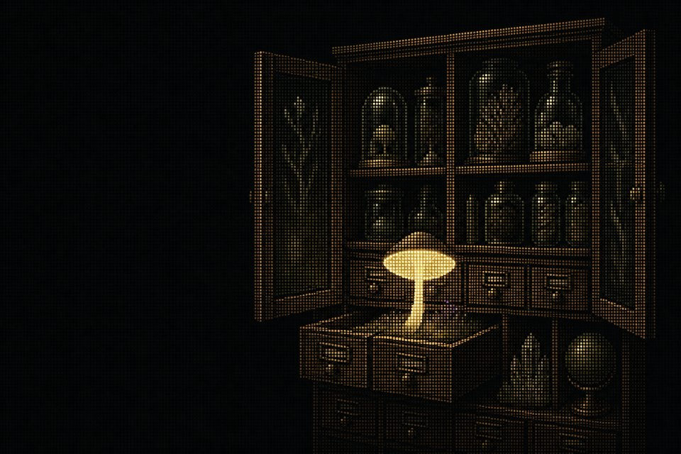
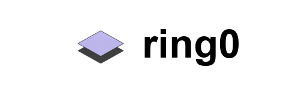

<p align="center">
  
</p>

<h1 align="center">Conjectures</h1>

<p align="center">
  Open conjectures tested by Lugel Labs — each with its paper, an exact verifier and the output to expect.
</p>

<p align="center">
  <a href="https://lugel.org/blog/math-conjectures"></a>
  <a href="#conjectures"></a>
  
  <a href="LICENSE"></a>
  <a href="LICENSE-CC-BY-4.0"></a>
</p>

---

<a id="conjectures"></a>

| Conjecture | Area | Date | Status | Links |
| :-- | :-- | :-- | :-: | :-: |
| **Binder–Vecchi real-rootedness** | Matroids | Nov 2026 |  | [](https://github.com/Lugel-Labs/conjectures/tree/binder-vecchi/binder-vecchi) [](https://lugel.org/blog/math-conjectures/binder-vecchi) |

## How this repository works

- **One branch per conjecture**, named after it. `main` holds only this index.
- **One folder per conjecture** on its branch, with the same name.
- **Every folder ships** the paper and its LaTeX source, a `requirements.txt`, a verifier, its expected output and a `SHA256SUMS.txt`.

```sh
git clone --branch binder-vecchi https://github.com/Lugel-Labs/conjectures.git
cd conjectures/binder-vecchi
```

> [!NOTE]
> The papers carry the proofs. The code checks specific computations; it is not a formal proof. Results are not independently reviewed unless a folder says so.

## License

Code is released under the [MIT License](LICENSE). Papers and their LaTeX sources are released under [CC BY 4.0](LICENSE-CC-BY-4.0).

---

<p align="center">
  <a href="https://r-0.org"><picture><source media="(prefers-color-scheme: dark)" srcset=".github/assets/ring0-wordmark-white.png"></picture></a>
  &nbsp;&nbsp;&nbsp;
  <a href="https://lugel.org"><picture><source media="(prefers-color-scheme: dark)" srcset=".github/assets/lugel-lockup-white.png"></picture></a>
  <br>
  <sub>Developed by Ring0 Labs · Published by Lugel Labs</sub>
</p>
